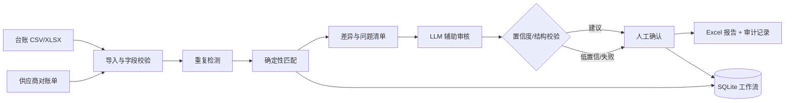

# 对账工作台 · Recon Workbench

> 面向企业财务场景的「对账 + 单据审核」工作台：确定性数据引擎负责把账对平，LLM 只解释需要判断的差异，所有结论可追溯、可复核。

[](https://github.com/haozhouliuliuliu/recon-workbench/actions/workflows/ci.yml)
[](https://www.python.org/)
[](LICENSE)
[](#数据声明)

## 业务场景

财务每月末要把内部系统导出的「应付台账」与供应商提供的「对账单」逐笔核对。实际工作里有三类重复劳动：

1. 字段清洗、日期/金额格式统一、重复发票识别；
2. 按供应商、发票号、金额做匹配，标出金额差异、单边缺失、重复单据；
3. 对差异逐条写处理建议，再交给财务确认。

这个项目把第 1、2 步做成确定性引擎，把第 3 步交给 LLM 做**辅助解释**，最终处理仍由人确认。适合作为企业财务、采购、共享服务中心的 AI 辅助审核原型，也适合作为「业务流程梳理 → AI 落地 → 人工复核」的演示。

## 能力范围

| 能力 | 实现 |
|---|---|
| 导入 | CSV / XLSX，自动识别 UTF-8 / BOM / GBK；中英文表头别名；缺列直接拒绝 |
| 数据校验 | 日期、金额、币种、发票号规则；逐行记录问题，不因一行坏数据中断整批 |
| 重复检测 | 完全重复（同源发票号）排除；疑似重复（同供应商+日期+金额）仅告警 |
| 匹配 | 供应商+发票号精确匹配；剩余记录按供应商+日期+金额唯一匹配；歧义不自动匹配 |
| LLM 审核 | 结构化输出 + Pydantic 校验；超时/坏 JSON/缺字段明确失败；低置信度转人工 |
| 工作流 | SQLite 状态机、任务身份、幂等重跑、中断恢复 |
| HTTP API | 上传、查询、下载、人工决策、恢复；统一错误结构 |
| 交付物 | 中文 Excel（汇总 / 明细 / 差异 / 重复 / 无效行 / 问题清单 / 运行信息） |

**关键边界：LLM 没有通过权。** 代码里不存在 `approved` 这类自动通过状态；`auto_suggested` 只是建议，最终必须由人确认。系统不接真实银行、ERP，不执行资金操作。

## 关键设计

- **确定性优先**：金额全程 `Decimal` + `ROUND_HALF_UP`，不经过 float；JSON 键排序、金额字符串化、只保留文件名、不写运行时间；同输入重复运行字节级一致，并带 SHA-256 摘要。
- **不猜**：同日同金额多候选不自动匹配；字段不合法不自动修正；模型输出不可信时转人工。
- **可追溯**：每条结论带问题码、来源行、匹配依据；LLM 审核记录 provider、model、阈值、逐条结论与摘要。
- **失败关闭**：超时、401、坏 JSON、缺字段、重试耗尽都记录明确错误码，不伪造成功。
- **人工在环**：`accepted / rejected / needs_info` 由人记录，系统只落库和导出。

## 架构



## 验证结果

- **200 个自动化测试**：引擎、LLM 结构化输出、工作流、API、配置、日志；
- 整体覆盖率 **91%**（`--cov=recon_workbench`），核心模块 90%+；
- CI：ruff + pytest（Python 3.11/3.12）+ 样例冒烟 + Docker 镜像内上传/下载端到端；
- 样例数据全部由脚本确定性生成，不含真实企业数据。

```bash
pytest -q --cov=recon_workbench
ruff check src tests scripts
```

## 快速开始

```bash
git clone https://github.com/haozhouliuliuliu/recon-workbench.git
cd recon-workbench

python -m venv .venv
# Windows: .venv\Scripts\activate    macOS/Linux: source .venv/bin/activate
pip install -e ".[dev]"

# 用内置虚构样例跑一遍对账
recon run --ledger sample_data/ledger_2026_08.csv \
          --statement sample_data/statement_2026_08.xlsx \
          --out-dir out/

# 无密钥演示 LLM 审核流程（stub）
recon review --report out/recon_report.json --stub

# 任务化运行：落库、可恢复、人工决策
recon workflow run --ledger sample_data/ledger_2026_08.csv \
                   --statement sample_data/statement_2026_08.xlsx \
                   --stub

# HTTP 接口：http://127.0.0.1:8000/docs
recon api
```

终端会打印各状态数量、双方合计、差额与报告摘要。产物：

- `out/recon_report.json`：规范化报告，可复核、可 diff；
- `out/recon_result.xlsx`：中文工作表；
- `out/review_report.json`：LLM 辅助审核结果（如启用）。

## 适用场景与可复用产出

- **业务流程梳理**：把「财务怎么对账」拆成可验证的匹配规则、异常类型和人工决策点；
- **AI 方案落地**：LLM 只处理差异解释，结构化输出 + 置信度 + 人工复核，避免让模型直接改数；
- **交付材料**：操作 SOP、已知限制、API 文档、Excel 交付格式；
- **效果验证**：固定样例、摘要 digest、200 个测试、CI 与 Docker 端到端，而不是只看一次演示。

## 目录结构

```text
recon-workbench/
├── src/recon_workbench/
│   ├── ingest.py         # CSV/XLSX 读取、编码探测、表头识别
│   ├── normalize.py      # 字段标准化与校验
│   ├── dedupe.py         # 重复/疑似重复检测
│   ├── reconcile.py      # 匹配算法（纯函数）
│   ├── pipeline.py       # 编排 + 规范化 JSON + 摘要
│   ├── export.py         # 中文 Excel 导出
│   ├── review/           # LLM 审核：schema / prompts / client / parser / service / report
│   ├── workflow/         # SQLite 工作流：db / repository / models / service
│   └── api/              # FastAPI：app / models / locks
├── tests/                # 200 个用例
├── sample_data/          # 100% 虚构的示例输入
├── scripts/              # 样例数据生成脚本
├── docs/                 # 技术结构 / 部署 / SOP / 已知限制
├── Dockerfile            # 非 root 运行、healthcheck
└── .github/workflows/    # CI：ruff + pytest + Docker 端到端
```

## 已知限制

- 接口默认无鉴权、无多租户，只适合本地/内网演示；公网部署前必须补充认证与 TLS；
- SQLite + 进程内锁是单进程假设，不支持多 worker/多节点；
- 没有任务调度、自动重试、产物 GC；失败任务需人工 resume；
- 不接真实银行/ERP，不做真实资金操作；
- LLM 审核是辅助，不替代财务判断；提示注入只做缓解，不可信单据仍需人工把关。

## 文档

- [技术结构说明](docs/architecture.md)
- [部署指南](docs/deployment.md)
- [操作 SOP](docs/sop.md)
- [已知限制](docs/known-limitations.md)

## 数据声明

**本项目所有业务数据均为虚构。** 公司名称、人名、银行账号、税号、电话、地址、发票号、订单号、金额均由脚本生成；银行账号为测试卡号格式。仓库不包含真实密钥，LLM key 只通过环境变量注入。

## 许可

[MIT](LICENSE)
